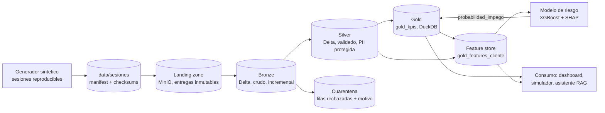

# Arquitectura

Como fluyen los datos de punta a punta, que hace cada zona, y por que se
tomo cada decision de diseno. Para correr el proyecto ver
`docs/ejecucion-local.md`; para el detalle de cada columna,
`docs/diccionario-datos.md`; para secretos y datos personales,
`docs/seguridad.md`.

## Vista general

Airflow orquesta todo el flujo con un DAG (`dags/gemelo_pipeline_dag.py`):
cada tarea lanza un contenedor `worker` efimero con PySpark, Delta Lake y
el codigo del proyecto. Airflow decide cuando y en que orden; el worker
hace el computo.

## Zonas y responsabilidades

| Zona | Donde vive | Responsabilidad | PII |
|---|---|---|---|
| Sesion | `data/sesiones/<id>/` | Fuentes sinteticas con sus parametros y checksums. Inmutable; se reutiliza si ya existe | En claro |
| Landing zone | MinIO, `landing/entregas/<id>/` | Historico de lo que realmente llego. Una entrega solo trae lo que no llego antes | En claro |
| Bronze | `data/bronze/` (Delta) | Registro fiel y acumulativo de lo ingerido, con trazabilidad por fila. Sin limpieza | En claro |
| Cuarentena | `data/silver_quarantine/` (Delta) | Foto de la ultima corrida: filas que violan una regla, con el motivo | Protegida |
| Registro de calidad | `data/calidad/` (Delta) | Historico de todas las corridas: incidencias por regla y perfil de nulos por columna | Sin valores |
| Silver | `data/silver/` (Delta) | Datos tipados, deduplicados y validados | Protegida |
| Gold | `data/gold/kpis.duckdb` | 12 KPIs por cliente y feature store | Sin PII |
| Modelo | `models/` | Clasificador de riesgo y grafico de importancia SHAP | Sin PII |
| Referencia de deriva | `models/referencia_psi/` | Linea base congelada del PSI: cortes y proporciones de entrenamiento y copia del modelo base | Sin PII |
| Deriva de datos | `data/calidad/deriva_psi/` (Parquet) | Historico del PSI por corrida y variable | Sin PII |
| Resumen del portafolio | `data/calidad/resumen_portafolio/` (Parquet) | Cifras de cabecera del portafolio por corte (`predict_risk.py`), para comparar contra la base | Sin PII |

## Tareas del DAG

| # | Tarea | Script | Que hace |
|---|---|---|---|
| 1 | `generar_fuentes_sinteticas` | `generate_synthetic_sources.py` | Genera (o reutiliza) la sesion de `config/sesion.yaml`, mas los meses adicionales que indique el disparo |
| 2 | `publicar_landing` | `publish_landing.py` | Publica la sesion como entrega en MinIO; solo sube lo nuevo |
| 3 | `ingesta_bronze` | `ingest_bronze.py --desde-landing` | Descarga y verifica las entregas pendientes; ingiere solo archivos no ingeridos |
| 4 | `transformacion_silver` | `transform_silver.py` | Tipado, deduplicacion, validacion por reglas, proteccion de PII, cuarentena |
| 5 | `transformacion_gold` | `transform_gold.py` | Calcula los 12 KPIs del catalogo en DuckDB |
| 6 | `construir_features` | `build_features.py` | Persiste `gold_features_cliente` |
| 7 | `generar_etiquetas` | `generate_labels.py` | Etiqueta de impago como evento posterior (modelo latente): escribe `gold_etiquetas_impago` y la auditoria fuera de Gold |
| 8 | `entrenar_modelo` | `train_model.py` | Entrena XGBoost con `gold_etiquetas_impago` y genera la importancia SHAP |
| 9 | `predict_risk` | `predict_risk.py` | Completa `probabilidad_impago` en Gold |
| 10 | `monitorear_deriva` | `monitor_drift.py` | PSI de cada feature numerica y del score contra la referencia congelada; agrega la corrida a `data/calidad/deriva_psi/` y alerta en el log sin detener el pipeline ([monitoreo-deriva.md](monitoreo-deriva.md)) |

Todos los pasos tambien se pueden correr sin Airflow con el CLI unico:
`python main.py <paso>` (o `bash demo.sh pipeline` en Docker).

## Configuracion declarativa

El comportamiento del pipeline se cambia editando configuracion, no
codigo:

| Archivo | Controla |
|---|---|
| `config/sesion.yaml` | Semilla, fecha de referencia y volumen de los datos |
| `config/ingresos.yaml` | Ingreso declarado por ocupacion, calibrado a clientes bancarizados urbanos de Mexico |
| `config/escalera_financiera.yaml` | Pasos y umbrales de la escalera financiera de la vista cliente, cada uno con su fuente |
| `config/mercado_mx.yaml` | Cifras de mercado de referencia (tasa objetivo de Banxico, CAT de BBVA y promedio, IVA sobre intereses con su fundamento), cada una con su fuente |
| `config/business_rules.yaml` | Reglas de calidad de Silver por entidad |
| `config/monitoreo_psi.yaml` | Intervalos, epsilon y umbrales (vigilar, reentrenar) del monitoreo de deriva |
| `config/politica_pii.yaml` | Que datos personales se protegen en Silver, y como |
| `config/kpi_catalog.yaml` | Metadata de los KPIs de Gold |

### Cifras externas

Toda cifra que no genera el proyecto (tasas, CAT, salarios, umbrales de
CONDUSEF) entra a la configuracion con valor, fuente, url, tipo de fuente
(primaria, secundaria o propia), fecha del dato y fecha de consulta. Primaria
es el organismo o la institucion (Banxico, CONDUSEF, CONASAMI, IMSS, INEGI, la
pagina del producto del banco); secundaria, un medio que los cita; propia, una
regla del proyecto sin fuente externa, dicha como tal. Sin fuente verificable,
`null` o propia, nunca un estimado atribuido a otro. Ejemplos:
`config/ingresos.yaml` y `config/escalera_financiera.yaml`.

## Decisiones de diseno

| Decision | Por que | Alternativa descartada |
|---|---|---|
| Lakehouse con patron Medallion | Conserva el dato crudo para auditoria y reproceso, con calidad creciente por capa | Data warehouse con esquema rigido desde el origen |
| Delta Lake en Bronze y Silver | Escrituras atomicas (ACID), versionado y evolucion de esquema (`mergeSchema`) | Parquet plano: una escritura interrumpida deja la tabla corrupta |
| DuckDB para Gold | Motor analitico sin servidor; suficiente para consultas de consumo | PostgreSQL: un servicio mas sin beneficio a esta escala |
| Validacion declarativa con motor generico y cuarentena | Una regla nueva es una linea de YAML; las filas invalidas se aislan sin detener el pipeline | Validaciones escritas a mano por entidad |
| Registro historico de calidad separado de la cuarentena | La cuarentena muestra el estado actual; el registro permite ver tendencias entre entregas sin guardar valores (sin PII) | Conservar cuarentenas viejas, que duplicarian la PII protegida |
| `try_cast` en el tipado de Silver | Spark 4 activa el modo ANSI: un cast invalido lanza error y detenia todo Silver por un solo valor corrupto | `cast` normal, o desactivar ANSI (ocultaria los errores en vez de registrarlos) |
| Sesiones reproducibles ancladas a una fecha de referencia | Los mismos parametros producen los mismos datos cualquier dia y en cualquier maquina | Fechas relativas al reloj del sistema (los datos cambiaban cada dia) |
| Landing zone inmutable + Bronze incremental con registro de control | Historico de lo recibido; reingerir no duplica; Bronze se reconstruye desde la landing zone | Sobrescribir Bronze completo en cada corrida |
| Validacion de CURP/RFC y HMAC como expresiones nativas de Spark | Spark las evalua dentro de la JVM y las optimiza con el resto del plan | UDFs de Python: serializan cada fila hacia otro proceso |
| Proteccion de PII al escribir Silver (hash con sal + enmascarado) | Permite unir y contar clientes sin exponer el dato; la PII en claro queda solo en zonas restringidas | Copiar la PII tal cual a todas las capas |
| Feature store persistido en Gold | Entrenamiento e inferencia leen la misma tabla; dashboard y asistente no necesitan Spark | Recalcular features en cada consumidor |
| Worker separado de Airflow (DockerOperator) | El orquestador no necesita Java ni Spark; el computo escala aparte | Correr Spark dentro del contenedor de Airflow |
| Secretos generados por maquina, fuera del repo | Ninguna credencial compartida ni versionada | Contrasenas fijas en `docker-compose.yml` |
| Streamlit para el dashboard (y, despues, el simulador y el asistente) | Una sola app de Python cubre los tres consumidores del feature store; lee `gold_kpis` y `gold_features_cliente` de DuckDB en solo lectura, sin Spark y sin un servicio mas en Docker Compose. Todo sigue corriendo local, con un comando | Looker Studio: es un servicio en la nube que no lee un DuckDB local, asi que exigiria exportar Gold y dar credenciales de Google al pipeline, el tablero no se reproduciria con `demo.sh` y no puede alojar el simulador ni el asistente (local, Ollama). Superset o Metabase: anaden servicios al Compose y solo resuelven el dashboard. Plotly Dash: mas codigo para el mismo resultado |
| Etiqueta de impago como evento posterior, con un modelo latente | La etiqueta ya no es funcion de las variables con las que se entrena: depende de ellas, de un rasgo oculto y de un choque que el modelo no ve, asi que el AUC mide poder predictivo y tiene un oraculo con el que compararse. Los parametros viven en `config/etiquetas_impago.yaml` | Regla sobre 3 variables mas un XOR de ruido: el modelo reconstruia la regla y el AUC medido era el ruido (ver `docs/technical-debt.md`) |
| Simulador Monte Carlo por remuestreo del historial del cliente (bootstrap), mas un choque de perdida de ingreso | No supone ninguna distribucion: un cliente informal produce trayectorias irregulares y uno formal estables, porque salen de sus propios meses. El choque agrega el riesgo que un ano de historial no contiene | Distribucion normal ajustada por cliente: con 12 meses no se puede estimar bien la cola, que es justo lo que importa |
| Mismos numeros aleatorios para todos los escenarios de una simulacion | Con y sin hipoteca, y cada precio de la busqueda de capacidad, se evaluan sobre los mismos meses y choques: la diferencia es el escenario, no el ruido, y la capacidad maxima es una frontera unica | Sortear de nuevo por escenario: diferencias de 1 o 2 puntos serian ruido |
| Capacidad hipotecaria como incremento de riesgo sobre el cliente sin hipoteca | Lo que se atribuye al credito es el riesgo que agrega. El enganche se evalua aparte (meses para reunirlo) | Umbral absoluto: con el choque de ingreso, muchos clientes superan el 5 % sin deber nada y nadie tendria capacidad. Descontar el enganche del saldo: casi toda simulacion empezaria en negativo |
| Asistente: el modelo de lenguaje enruta y Python calcula (`asistente/herramientas.py`) | El modelo elige una herramienta y sus argumentos; las cifras salen de las mismas consultas que el dashboard y el simulador, asi que el asistente no puede dar un numero distinto del de las vistas, y cada cifra se puede rastrear a una consulta. El cliente lo fija la interfaz: ningun esquema expone `cliente_id` | Que el modelo calcule o lea tablas en el prompt (un modelo de 8B inventa o redondea cifras), o que escriba SQL (otra superficie que validar y que puede consultar a cualquier cliente) |
| `normalizar()` como unica entrada de los argumentos del modelo | Salio de fallos reales de `llama3.1:8b` en el sondeo (`experimentos/sondeo_herramientas.py`): numeros y listas como texto, `"None"` para omitir, `desde` y `ultimos_meses` a la vez con `desde` mal calculado. Un solo lugar corrige esos casos para todas las herramientas y deja cada correccion en el log; el log solo registra argumentos del esquema y reemplaza cualquier texto libre por su largo | Validar en cada herramienta (una copia de las mismas reglas por herramienta), o rechazar y pedir al modelo que reintente (mas latencia y el mismo error en la segunda vuelta) |
| En el asistente, un rango o una categoria validos sin movimientos devuelven 0, no un error | "Cuanto gaste en comida en marzo" con 0 de gasto es una respuesta; como error, el modelo la contaba como falla. El error queda para argumentos invalidos (categoria inexistente, mes mal escrito, rango fuera de los datos) y lista los valores validos para que el modelo corrija | Error para los dos casos |
| Guardas deterministas antes de ejecutar una herramienta (`asistente/origen.py`) | Con `llama3.1:8b` el prompt no alcanzo: inventaba precios ("un BMW M4" llegaba con 2,500,000), tasas y enganches, y evaluaba un departamento como compra general. Un precio, plazo, tasa, enganche o renta solo se acepta si ese numero aparece en lo que escribio el usuario: si el dato es opcional se descarta y la herramienta usa su valor por defecto; si es obligatorio, el modelo recibe un error que le pide preguntarlo. Una vivienda evaluada con `evaluar_compra` se redirige a `simular_hipoteca` | Pedirle al modelo que corrija tras un rechazo (preguntaba al usuario datos que tenian valor por defecto), o confiar en el prompt |
| Las herramientas devuelven la lectura ya armada (`lectura`) ademas de las cifras | Con los numeros sueltos el modelo hacia sus propias cuentas o tomaba el campo equivocado: contesto "cuanto pague de deuda" con el total de todas las salidas y leyo 99.98 % de deficit como "muy baja". La frase la arma Python, con la advertencia cuando con la compra es mas probable quedar en saldo negativo que no | Solo cifras, y reglas de redaccion en el prompt |
| Recomendaciones de inversion se detienen antes del modelo (`asistente/alcance.py`) | Una regla aislada con su prueba: ajustar el limite es cambiar un archivo. El modelo, ante "que acciones me recomiendas", llamaba a una herramienta en vez de negarse. Provisional hasta definir el limite en la sesion de seguimiento | Una regla en el prompt (el modelo no la siguio) |
| Escalera financiera calculada en Python (`src/gold/escalera.py`) | El paso de cada cliente lo deciden reglas con fuente (`config/escalera_financiera.yaml`); el asistente solo lo explica. La deuda se mide como CONDUSEF: pago mensual comprometido (cuota del prestamo y pago minimo de tarjeta de Banxico, con IVA sobre intereses) entre ingreso neto, con el mes de menor ingreso para ingreso variable. El pago observado es una senal (meses sin pago), no la medida: con el observado, el cliente que deja de pagar se veria menos endeudado. `ratio_endeudamiento` (saldo entre ingreso) queda como medida aparte; en la instancia, 199 de 333 clientes con deuda cambian de resultado segun cual se use | Que el modelo decida el paso; usar los pagos observados o `ratio_endeudamiento` para la regla del 30 % |

## Como se verifica

| Garantia | Verificacion |
|---|---|
| El pipeline corre de punta a punta | Smoke test de CI: generador, Bronze, Silver, Gold, features y modelo con volumen reducido |
| Los datos son reproducibles | CI regenera la sesion desde cero y compara checksums |
| La ingesta es incremental e idempotente | CI reingiere (no agrega nada) y aplica una entrega nueva (agrega solo su mes) |
| Silver no contiene PII en claro | `transform_silver.py` se detiene si un campo sensible llega a la escritura; CI lo vuelve a revisar |
| CURP/RFC se validan igual en Spark que en Python | `tests/test_pii.py`, 150 casos validos y alterados |
| No hay secretos ni datos en el repo | Escaneo de secretos y de archivos de datos en cada PR |
| Un valor corrupto no detiene el pipeline | `tests/test_calidad.py`: fechas imposibles, montos mal formados y valores fuera de catalogo van a cuarentena |
| Ninguna fila desaparece en la validacion | Toda violacion se normaliza a verdadero/falso; validas + cuarentena = filas de entrada |
